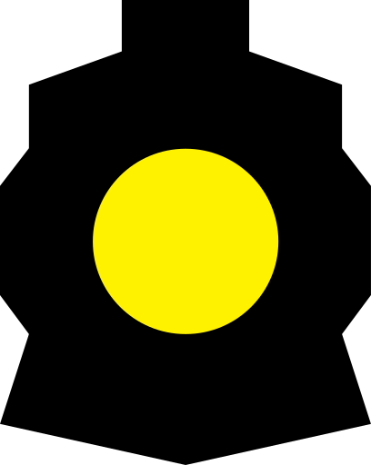
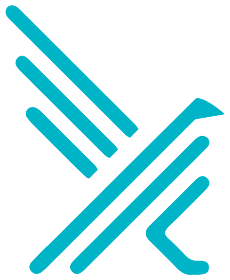
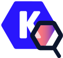
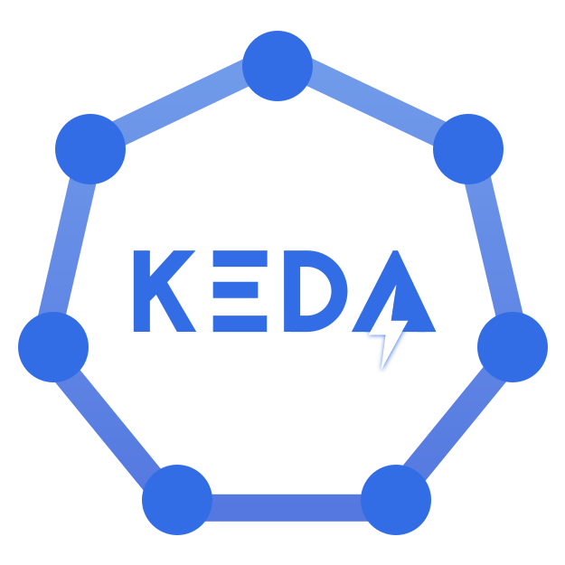
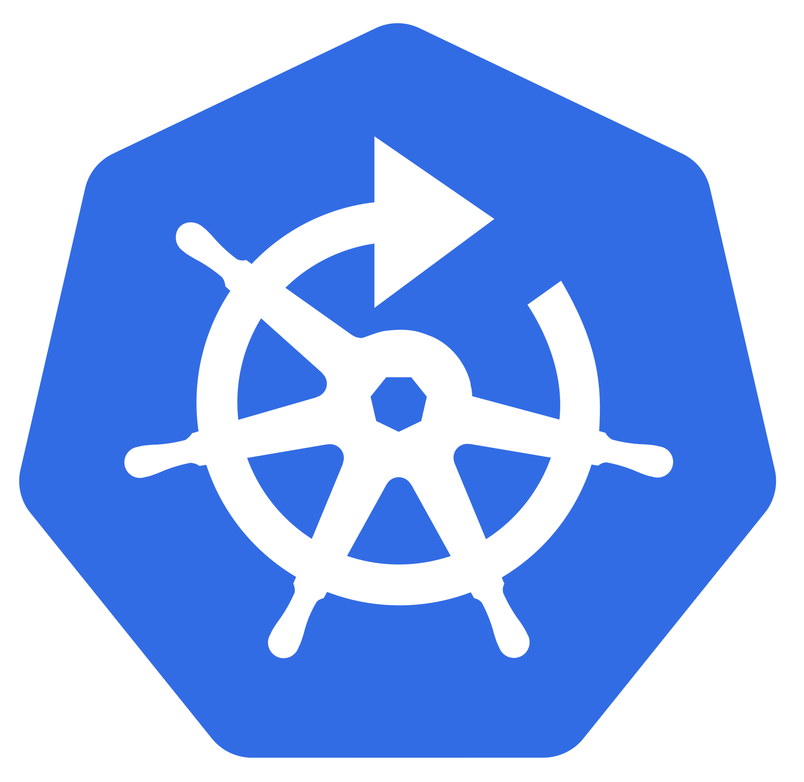
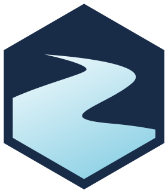

# ITCS Catalog for Nutanix NKP

[](https://github.com/Fen0l/nutanix-nkp-lab-catalog/actions/workflows/validate.yaml)
[](https://github.com/Fen0l/nutanix-nkp-lab-catalog/actions/workflows/e2e.yaml)
[](https://github.com/Fen0l/nutanix-nkp-lab-catalog/actions/workflows/publish.yaml)
[](#applications)
[](docs/VERSIONS.md)
[](https://portal.nutanix.com/page/documents/details?targetId=Nutanix-Kubernetes-Platform-v2_18)
[](https://kubernetes.io/)
[](https://github.com/Fen0l/nutanix-nkp-lab-catalog/pkgs/container/nutanix-nkp-lab-catalog%2Fcollection)
[](LICENSE)

44 widely used Kubernetes tools for the **Nutanix Kubernetes Platform (NKP)**, one click away in the
NKP UI. Every entry is the **upstream Helm chart with upstream defaults**; the catalog only adds the
NKP metadata, the ingress and dashboard card for web UIs, and the few values a chart cannot start
without. Everything is tested on NKP 2.18 and on kind before it is published.

> Not an official Nutanix product, not supported by Nutanix or the upstream projects. Labs and demos
> only. For Nutanix products use the [Nutanix Product Catalog](https://github.com/nutanix-cloud-native/nkp-nutanix-product-catalog)
> and the [Partner Catalog](https://github.com/nutanix-cloud-native/nkp-partner-catalog).

## Quick start

NKP **2.18**, **Ultimate** licence, management cluster able to reach `ghcr.io`.

```bash
nkp create catalog-collection \
  --url oci://ghcr.io/fen0l/nutanix-nkp-lab-catalog/collection \
  --tag 2.18 \
  --workspace kommander-workspace
```

Then **Workspace → Applications** in the NKP UI, filter by category (`gitops`, `security`,
`observability`, ...). Pick one, **Enable**, **Deploy**. Apps with a web UI get a card with an open button
on the cluster page. Each application page shows the exact values the catalog sets, how to reach
the tool and what to know on NKP 2.18.

The CLI equivalent:

```bash
kubectl get apps -n kommander
nkp create appdeployment podinfo --app podinfo-6.15.0 --workspace <workspace>
```

Some UIs cannot run under a sub-path (OpenBao, Argo Rollouts, Gitea, Backstage, Policy Reporter,
Falco, Litmus, Portainer): enabling them asks for the cluster's **ingress domain** and serves them as
`<app>.<domain>`. Point a wildcard DNS record `*.<domain>` at the NKP Traefik address, or use
`<traefik-ip>.nip.io`.

## Applications

Grouped by the category shown in the NKP UI. Chart = Helm chart version, App = application version. Instances: *one per cluster* entries are
enabled from a workspace; *per project / workspace* entries can be deployed several times, each in
its own namespace. Web UI is served by the NKP Traefik on the cluster ingress.

### `gitops`

| | Application | Chart | App | Instances | Web UI | Requires |
|---|---|---|---|---|---|---|
|  | [Argo CD](applications/argo-cd) | 10.10.3 | v3.5.5 | one per cluster | `/argo-cd/` |  |
|  | [Argo Workflows](applications/argo-workflows) | 2.0.12 | v4.1.5 | one per cluster | `/argo-workflows/` |  |
|  | [Argo Events](applications/argo-events) | 2.4.27 | v1.9.11 | one per cluster |  |  |
|  | [Argo Rollouts](applications/argo-rollouts) | 2.43.6 | v1.10.0 | one per cluster | `rollouts.<domain>` |  |
|  | [Flagger](applications/flagger) | 1.45.0 | 1.45.0 | one per cluster |  |  |
|  | [Sealed Secrets](applications/sealed-secrets) | 2.20.0 | 0.40.0 | one per cluster |  |  |

### `developer-tools`

| | Application | Chart | App | Instances | Web UI | Requires |
|---|---|---|---|---|---|---|
|  | [Gitea](applications/gitea) | 12.7.0 | 1.27.0 | per project / workspace | `gitea.<domain>` |  |
|  | [Jenkins](applications/jenkins) | 5.9.68 | 2.580.1 | one per cluster | `/jenkins/` |  |
|  | [Backstage](applications/backstage) | 2.10.2 | demo image | per project / workspace | `backstage.<domain>` |  |
|  | [Podinfo](applications/podinfo) | 6.15.0 | 6.15.0 | per project / workspace | `/<instance>/` |  |
|  | [Headlamp](applications/headlamp) | 0.45.0 | 0.45.0 | one per cluster | `/headlamp/` |  |
|  | [Portainer CE](applications/portainer) | 245.2.0 | 2.45.2 | one per cluster | `portainer.<domain>` |  |
|  | [vCluster](applications/vcluster) | 0.37.3 | 0.37.3 | per project / workspace |  |  |

### `testing`

| | Application | Chart | App | Instances | Web UI | Requires |
|---|---|---|---|---|---|---|
|  | [k6 Operator](applications/k6-operator) | 4.6.0 | 1.6.0 | one per cluster |  |  |
|  | [LitmusChaos](applications/litmus) | 3.30.0 | 3.30.0 | one per cluster | `litmus.<domain>` |  |

### `security`

| | Application | Chart | App | Instances | Web UI | Requires |
|---|---|---|---|---|---|---|
|  | [Falco](applications/falco) | 9.2.0 | 0.45.0 | one per cluster | `falco.<domain>` |  |
|  | [Tetragon](applications/tetragon) | 1.7.1 | 1.7.1 | one per cluster |  |  |
|  | [Trivy Operator](applications/trivy-operator) | 0.32.1 | 0.30.1 | one per cluster |  |  |
|  | [Kubescape Operator](applications/kubescape-operator) | 1.40.5 | 1.40.5 | one per cluster |  |  |
|  | [Kyverno](applications/kyverno) | 3.9.1 | v1.19.1 | one per cluster |  |  |
|  | [Kyverno Policies (Pod Security)](applications/kyverno-policies) | 3.9.1 | v1.19.1 | one per cluster |  | kyverno |
|  | [Policy Reporter](applications/policy-reporter) | 3.11.0 | 3.11.0 | one per cluster | `policy-reporter.<domain>` | kyverno, trivy-operator |
|  | [OpenBao](applications/openbao) | 0.30.3 | v2.7.1 | one per cluster | `openbao.<domain>` |  |
|  | [Keycloak](applications/keycloak) | 7.3.2 | 26.7.4 | one per cluster | `/keycloak/` |  |
|  | [trust-manager](applications/trust-manager) | 0.25.0 | v0.25.0 | one per cluster |  | cert-manager |
|  | [cert-manager approver-policy](applications/cert-manager-approver-policy) | 0.28.0 | v0.28.0 | one per cluster |  | cert-manager |
|  | [Capsule](applications/capsule) | 0.14.6 | 0.14.6 | one per cluster |  | cert-manager |

### `observability`

| | Application | Chart | App | Instances | Web UI | Requires |
|---|---|---|---|---|---|---|
|  | [OpenTelemetry Collector](applications/opentelemetry-collector) | 0.175.1 | 0.161.0 | per project / workspace |  |  |
|  | [Grafana Tempo](applications/tempo) | 1.24.4 | 2.9.0 | per project / workspace |  |  |
|  | [VictoriaLogs](applications/victoria-logs) | 0.13.10 | v1.53.0 | one per cluster | `/victoria-logs/select/vmui/` |  |

### `networking`

| | Application | Chart | App | Instances | Web UI | Requires |
|---|---|---|---|---|---|---|
|  | [NGINX Ingress Controller](applications/ingress-nginx) | 4.15.1 | 1.15.1 | one per cluster |  |  |

### `api-gateway`

| | Application | Chart | App | Instances | Web UI | Requires |
|---|---|---|---|---|---|---|
|  | [Envoy Gateway](applications/envoy-gateway) | 1.9.2 | v1.9.2 | one per cluster |  |  |
|  | [NGINX Gateway Fabric](applications/nginx-gateway-fabric) | 2.7.2 | 2.7.2 | one per cluster |  | gateway-api-crds |

### `infrastructure`

| | Application | Chart | App | Instances | Web UI | Requires |
|---|---|---|---|---|---|---|
|  | [KEDA](applications/keda) | 2.21.0 | 2.21.0 | one per cluster |  |  |
|  | [KEDA HTTP Add-on](applications/keda-add-ons-http) | 0.16.0 | 0.16.0 | one per cluster |  | keda |
|  | [Descheduler](applications/descheduler) | 0.37.0 | 0.37.0 | one per cluster |  |  |
|  | [Kured (Reboot Daemon)](applications/kured) | 6.1.0 | 1.23.0 | one per cluster |  |  |
|  | [Reflector](applications/reflector) | 10.0.65 | 10.0.65 | one per cluster |  |  |
|  | [Crossplane](applications/crossplane) | 2.4.2 | 2.4.2 | one per cluster |  |  |
|  | [Dapr](applications/dapr) | 1.18.7 | 1.18.7 | one per cluster |  |  |

### `data`

| | Application | Chart | App | Instances | Web UI | Requires |
|---|---|---|---|---|---|---|
|  | [Strimzi (Apache Kafka)](applications/strimzi-kafka-operator) | 1.3.0 | 1.3.0 | one per cluster |  |  |
|  | [Kafka UI (Kafbat)](applications/kafka-ui) | 1.6.5 | v1.5.0 | one per cluster | `/kafka-ui/` |  |
|  | [MongoDB Community Operator](applications/mongodb-community-operator) | 0.13.0 | 0.13.0 | one per cluster |  |  |
|  | [Redis Operator (OT)](applications/redis-operator) | 0.27.0 | 0.27.0 | one per cluster |  |  |

Versions versus upstream, refreshed daily: [docs/VERSIONS.md](docs/VERSIONS.md).

**Already in NKP, therefore not duplicated here**: cert-manager, kube-prometheus-stack, Grafana,
Loki, Fluent Bit, Velero, Harbor, Istio, Kiali, Jaeger, Gatekeeper, External Secrets, External DNS,
CloudNativePG, Traefik, Rook Ceph, Knative, NVIDIA GPU Operator, Kubernetes Dashboard, Gateway API
CRDs (platform applications), plus NDK, NAI, KServe, OpenTelemetry Operator, Envoy Gateway NAI,
Kueue and the AI stack (Nutanix product and AI catalogs). Hubble relay already runs on NKP Cilium
clusters; Hubble UI is a value toggle on the existing Cilium release, not a separate chart.

## How it works

- `nkp create catalog-collection` registers the OCI collection; Kommander creates one `App` per
  `applications/<app>/<version>/` and the UI lists them.
- Enabling an app creates an `AppDeployment`; Kommander applies the entry's Flux `Kustomization`
  to the target cluster, which pulls the chart and reconciles the `HelmRelease`.
- Overrides are a ConfigMap `<app>-config-overrides` (key `values.yaml`) referenced by the
  AppDeployment; the catalog's own values are the ConfigMap `<app>-config-defaults`.
- New chart version = new `<version>/` directory, never an in-place edit; a daily workflow opens
  one pull request per outdated application.


## License

Apache-2.0 for the catalog manifests and tooling. Each packaged application keeps its own
upstream licence.
